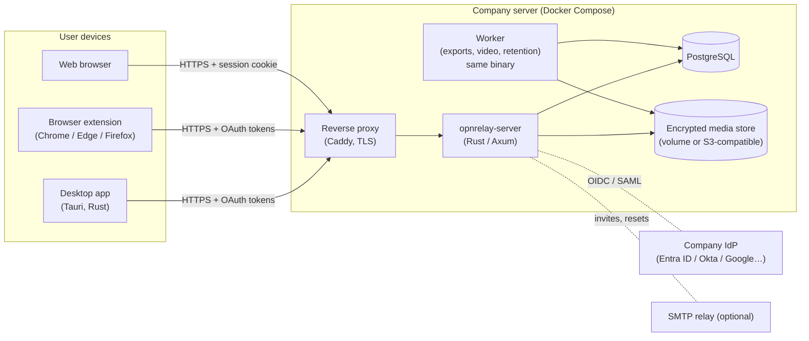
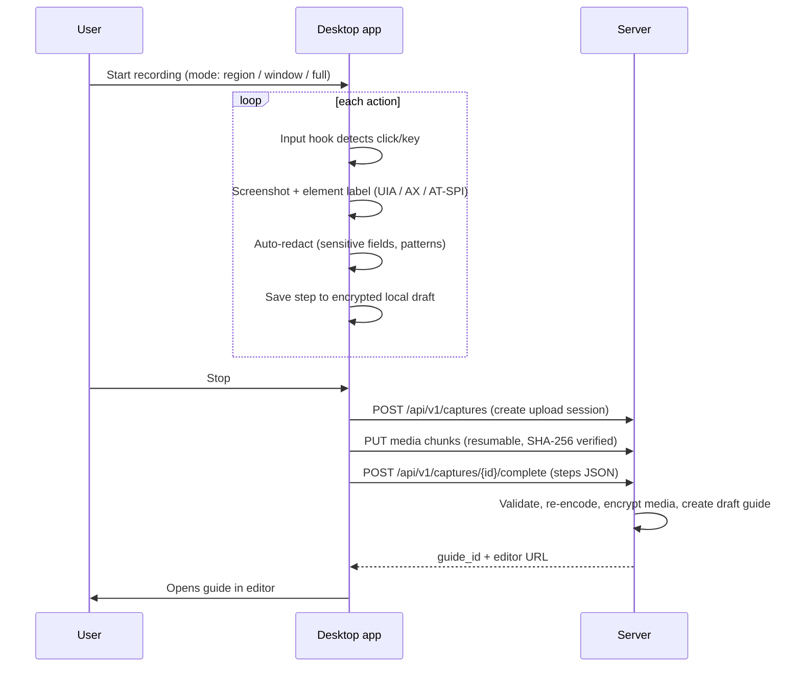

# Architecture

## 1. Overview



Everything except the user devices runs on one company-controlled machine. The server
binary runs in two modes, `serve` (HTTP API + web UI) and `worker` (background jobs).
By default both modes run in the same container. For larger installs they can be split.

## 2. Components

### 2.1 `opnrelay-server`
- **Axum** HTTP server on **Tokio**; **SQLx** (compile-time checked queries) against PostgreSQL 16.
- Serves the compiled web UI (static assets embedded with `rust-embed`), the REST API (`/api/v1`), OAuth endpoints for native clients, and public share pages.
- **Background jobs**: a Postgres-backed job queue (`SELECT … FOR UPDATE SKIP LOCKED`), so no Redis is needed. Jobs: export rendering, video transcoding/GIF generation, thumbnail generation, retention enforcement, audit chain checkpoints, email.
- **Media service**: streams uploads, validates type by magic bytes, strips metadata (EXIF), re-encodes images, encrypts at rest (see [security.md](security.md)), and serves via short-lived signed URLs.
- **Search**: PostgreSQL full-text search (`tsvector`) over guide titles, step text and element labels. This is enough for the target scale and needs no extra service.
- **OpenAPI** spec generated from code with `utoipa`.

### 2.2 Web app (`apps/web`)
- Svelte + TypeScript, built to static assets and embedded in the server binary.
- The same component library is reused by the desktop app's UI (Tauri webview).
- Strict CSP; no inline scripts; no third-party CDNs.

### 2.3 Desktop app (`apps/desktop`)
- **Tauri 2**: Rust core plus the system webview (WebView2 / WKWebView / WebKitGTK).
- Rust crates do the heavy lifting: `opnrelay-capture` (input hooks, screenshots, video), `opnrelay-redact` (local redaction), and the local encrypted draft store (SQLite via `rusqlite` + SQLCipher).
- Signed auto-updates (Tauri updater with ed25519 signatures) pointing at the company's own server or GitHub Releases; configurable.
- See [capture.md](capture.md) for platform details.

### 2.4 Browser extension (`apps/extension`)
- Manifest V3, TypeScript, single codebase built for Chromium (Chrome/Edge) and Firefox.
- Content script records DOM events and resolves human-readable element labels (ARIA label, `<label for>`, button text, placeholder); the service worker captures the visible tab and uploads.
- Redaction runs in the content script **before** the screenshot is taken: sensitive elements are masked in the DOM via overlay, so the pixels never exist unredacted.

### 2.5 Shared Rust crates

| Crate | Purpose |
|---|---|
| `opnrelay-core` | Domain types (Guide, Step, Action, Annotation), validation, step-title generation |
| `opnrelay-capture` | Cross-platform input/screenshot/video capture (desktop only) |
| `opnrelay-redact` | Pattern detection + pixel redaction (shared by desktop and server-side manual redaction) |
| `opnrelay-export` | PDF (Typst), DOCX, HTML, Markdown, image zip, GIF |
| `opnrelay-crypto` | Envelope encryption, key wrapping, token hashing helpers |
| `opnrelay-server` | HTTP API, auth, persistence, jobs |
| `opnrelay-client` | Typed API client shared by the desktop app and CLI |

## 3. Key flows

### 3.1 Desktop recording → guide



### 3.2 Export
1. User requests export → `POST /api/v1/guides/{id}/exports {format, options}`.
2. The server checks permission and policy, writes an audit event, and enqueues a job.
3. The worker renders with `opnrelay-export` using the org's branding and stores the result encrypted with a 24 h TTL.
4. The client polls or receives a server-sent event, then downloads via a signed URL.

Small exports (Markdown, HTML under 10 steps) may render synchronously.

## 4. Repository layout (planned)

```
opnrelay/
├── Cargo.toml                 # workspace
├── crates/
│   ├── opnrelay-core/
│   ├── opnrelay-capture/
│   ├── opnrelay-redact/
│   ├── opnrelay-export/
│   ├── opnrelay-crypto/
│   ├── opnrelay-client/
│   └── opnrelay-server/
│       └── migrations/
├── apps/
│   ├── web/                   # Svelte UI (also used by desktop)
│   ├── desktop/               # Tauri app (src-tauri/ + UI)
│   └── extension/             # MV3 extension (chromium + firefox builds)
├── deploy/
│   ├── docker/Dockerfile
│   ├── compose.yaml
│   └── Caddyfile
├── docs/
└── .github/workflows/         # CI: lint, test, audit, build, sign, release
```

## 5. Technology choices (summary)

| Concern | Choice | Why |
|---|---|---|
| Language | Rust (backend, desktop core, export) | Memory safety, small binaries, performance |
| HTTP | Axum + Tower | Mature, composable middleware (rate limits, tracing) |
| DB | PostgreSQL 16 + SQLx | Concurrency, full-text search, row-level integrity; [ADR 0002](adr/0002-postgresql.md) |
| Desktop | Tauri 2 | ~10 MB vs ~150 MB Electron; Rust core; [ADR 0001](adr/0001-tauri-desktop.md) |
| UI | Svelte + TS | Small bundles, shared between web and desktop; [ADR 0003](adr/0003-web-ui-svelte.md) |
| PDF | Typst (embedded as a library) | High-quality typesetting, pure Rust, templatable branding; [ADR 0004](adr/0004-export-rendering.md) |
| DOCX | `docx-rs` | Pure Rust |
| Video | Platform encoders on the client; server-side `ffmpeg` (LGPL build) in the worker image for transcode/GIF | Hardware acceleration, broad format support |
| Auth | `argon2`, `totp-rs`, `webauthn-rs`, `openidconnect`, `samael` (SAML) | Well-reviewed crates |
| Jobs | Postgres queue | One fewer service to run and secure |
| Reverse proxy | Caddy | Automatic TLS (ACME or internal CA) |
| Observability | `tracing` → JSON logs; optional Prometheus `/metrics` and OpenTelemetry | Opt-in, no phone-home |
