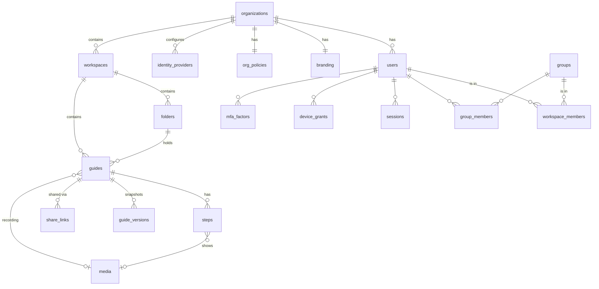

# Data Model

PostgreSQL 16. All primary keys are **UUIDv7** (time-ordered, non-enumerable) unless
noted. Timestamps are `timestamptz` in UTC. Soft-deleted rows carry `deleted_at`.
Migrations live in `crates/opnrelay-server/migrations/` (SQLx).

An installation hosts **one organisation** (one company). The `organizations` table
exists so branding and settings have a home, and to allow multi-org later without a rewrite.

## 1. Entity overview



## 2. Tables

### Identity & access

**organizations**: `id, name, slug, created_at`

**users**
| column | type | notes |
|---|---|---|
| id | uuid | |
| org_id | uuid FK | |
| email | citext unique | |
| display_name | text | |
| password_hash | text null | Argon2id PHC string; null for SSO-only users |
| org_role | enum `owner, admin, member, auditor` | |
| status | enum `invited, active, disabled` | |
| auditor_scope | enum `all, granted` | only for auditors |
| last_login_at, created_at, updated_at, deleted_at | timestamptz | |

**mfa_factors**: `id, user_id, kind (totp|webauthn), label, secret_enc bytea (TOTP), credential jsonb (WebAuthn), created_at, last_used_at`

**recovery_codes**: `id, user_id, code_hash, used_at`

**identity_providers**: `id, org_id, kind (oidc|saml), name, config_enc bytea, enabled, jit_provisioning bool, default_role, group_mapping jsonb`

**user_identities**: `user_id, idp_id, subject, unique(idp_id, subject)`

**sessions** (web): `id, user_id, token_hash, created_at, last_seen_at, expires_at, ip inet, user_agent, mfa_at`

**device_grants** (desktop/extension): `id, user_id, client_kind (desktop|extension), device_name, refresh_token_hash, family_id, created_at, last_used_at, revoked_at`

**invitations**: `id, org_id, email, org_role, token_hash, invited_by, expires_at, accepted_at`

**groups**: `id, org_id, name, source (manual|idp), external_id`
**group_members**: `group_id, user_id`

### Workspaces & content

**workspaces**
| column | type | notes |
|---|---|---|
| id, org_id, name, slug | | |
| policy_overrides | jsonb | e.g. capture modes allowed, retention |
| legal_hold | bool | |
| review_period_days | int null | guides not reviewed within this many days are flagged "needs review"; NULL = off; default 90 |

**workspace_members**: `workspace_id, principal_type (user|group), principal_id, role (manager|editor|viewer)`

**folders**: `id, workspace_id, parent_id null, name, position`

**guides**
| column | type | notes |
|---|---|---|
| id | uuid | |
| workspace_id, folder_id | uuid | |
| title, description | text | |
| status | enum `draft, published, archived` | |
| classification | enum `internal, confidential, restricted` | drives footer/watermark |
| source | enum `desktop, extension, manual` | |
| recording_media_id | uuid null | video, if recorded |
| current_version | int | |
| tags | text[] | |
| search | tsvector | generated from title/description/step text |
| legal_hold | bool | |
| created_by, updated_by | uuid | |
| reviewed_at | timestamptz | last publish or "Still accurate"; with the workspace period gives `review_due_at` / `needs_review` (computed, not stored) |
| created_at, updated_at, published_at, deleted_at | | |

**steps**
| column | type | notes |
|---|---|---|
| id, guide_id | uuid | |
| position | int | unique(guide_id, position) deferrable |
| kind | enum `action, text, heading, tip, alert` | |
| title | text | |
| body_md | text | sanitised Markdown subset |
| action | jsonb | `{type, target_label, target_role, app, window_title, url, x, y, viewport, ts, video_ms}` |
| media_id | uuid null | screenshot |
| annotations | jsonb | highlight rect, arrows, boxes, text, blur regions (vector, re-renderable) |

**guide_versions**: `guide_id, version, snapshot jsonb, created_by, created_at, note`. Published versions are immutable.

**media**
| column | type | notes |
|---|---|---|
| id | uuid | |
| kind | enum `image, video, gif, logo, export` | |
| mime | text | |
| storage_key | text | path in object store |
| sha256 | bytea | of plaintext |
| bytes, width, height, duration_ms | | |
| dek_wrapped | bytea | per-object data key wrapped with KEK |
| kek_id | text | for rotation |
| redacted | bool | |
| original_media_id | uuid null | only when policy allows keeping originals |
| expires_at | timestamptz null | exports |
| created_by, created_at | | |

**share_links**: `id, guide_id, scope (org|public), token_hash, password_hash null, expires_at, allow_download bool, created_by, created_at, revoked_at, view_count`

**embed_origins**: `org_id, origin`

### Settings

**branding** (1:1 with org): `logo_media_id, logo_dark_media_id, primary_color, accent_color, font_family, header_text, footer_text, cover_page bool, show_step_numbers bool, watermark_exports bool`

**org_policies** (1:1): `mfa_requirement, sso_only, session_idle_minutes, session_absolute_hours, public_links_enabled, max_public_link_days, default_capture_mode, auto_redaction_default, redaction_patterns jsonb, retention jsonb`. These are defaults and optional org-wide switches; all start permissive.

**user_preferences**: `user_id, capture_mode, auto_redaction bool, include_typed_text bool, region_size`

### Operations

**jobs**: `id bigserial, kind, payload jsonb, status (queued|running|done|failed), attempts, run_after, locked_by, locked_at, error, created_at`

**export_jobs**: `id, guide_id(s), requested_by, format, options jsonb, job_id, result_media_id, status, created_at`

**audit_events** (append-only)
| column | type | notes |
|---|---|---|
| seq | bigserial PK | strict order |
| ts | timestamptz | |
| actor_id | uuid null | null for system/anonymous |
| actor_label | text | pseudonymised after user erasure |
| actor_ip | inet | |
| action | text | e.g. `guide.export`, `auth.login.failed` |
| target_type, target_id | text, uuid | |
| metadata | jsonb | |
| prev_hash | bytea | |
| hash | bytea | `sha256(prev_hash ‖ canonical_json(event))` |

The application DB role has `INSERT, SELECT` only on `audit_events`. Checkpoints
(`audit_checkpoints: seq, hash, signed_at, signature`) are written daily and can be
exported off-box.

## 3. Object storage layout

```
media/
  {yyyy}/{mm}/{media_id}        # encrypted blob (nonce || ciphertext || tag)
exports/
  {yyyy}/{mm}/{media_id}        # encrypted, TTL-expired by worker
```

Object names never contain titles, emails, or other identifying data.

## 4. Search

`guides.search` is a generated `tsvector` (weighted: title A, description B, steps C),
maintained by trigger on step changes. Queries use `websearch_to_tsquery`. Results are
filtered by the authorisation layer **inside SQL** (join on accessible workspace IDs) so
results never leak titles the user cannot see.
